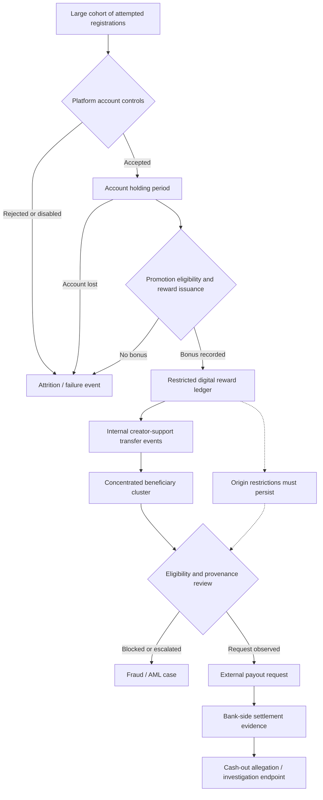
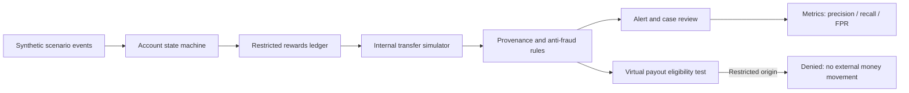

# CASE 001 — Пятёрочка × ВКонтакте / Defensive investigation map

**Branch:** `case-001-defensive-map`  
**Status:** Alleged historical account/reward abuse, user narrative only, not independently verified.  
**Purpose:** Incident reconstruction, provenance analysis, synthetic data, detection controls. Not an operational guide.

## High-level money/value movement

The diagram abstracts away actionable execution detail. It does not depict device allocation, SIM provisioning, proxy or clicker configuration, automated verification, use of others' payment credentials, payout-routing recipes or cash withdrawal instructions.

## Reported platform roles (unverified)

- **Пятёрочка** — alleged source of the promotional campaign.
- **ВКонтакте (VK)** — alleged environment for account registration, promotional digital rewards and streaming monetization.
- **Payment providers** — alleged downstream payout environment; specific institutions are not identified.

These labels come from the narrator's recollection and do **not** establish a verified vulnerability or wrongdoing by the named companies.

## Reported context (unverified)

- Roughly **5,000 account attempts per day**.
- End-to-end usable bonus yield **slightly under 50%**, including unsuitable phone numbers, platform blocks, lost accounts while waiting, and missing bonuses.
- Activity lasted **slightly less than a month**; exact dates and daily variation unknown.
- Internal digital rewards reportedly flowed toward **five primary beneficiary accounts**.
- Approximate aggregate proceeds alleged: **RUB 2 million**, neither audited nor substantiated here.
- Account activity was reportedly heavily automated, and later payment/cash-out activity involved multiple instruments and institutions. These allegations are retained only as investigative categories.

## Defensive event catalog

| Event | Fields to capture (fictional IDs only) | Defensive question |
|---|---|---|
| account_attempt | synthetic_actor_id, attempt_id, time_bucket | Volume, bursts and linked actors |
| registration_result | attempt_id, status, reason_code | False-account controls and rejection accuracy |
| holding_result | synthetic_actor_id, wait_bucket, account_status | Attrition by stage |
| reward_decision | actor_id, synthetic_reward_id, decision | Did ineligible issuances occur? |
| internal_value_transfer | from_id, to_id, unit_amount, provenance_tag | Is restricted origin preserved? |
| beneficiary_concentration | beneficiary_id, distinct_sources, time_bucket | Are many new sources converging? |
| redemption_request | beneficiary_id, balance_origin, outcome | Did redemption rules reject restricted value? |
| review_outcome | case_id, disposition, evidence_keys | Explainable review and false positives |

## Controlled lab diagram

## Detection and prevention

1. Maintain source-of-value restrictions across all internal asset transformations.
2. Detect coordinated populations through lawful aggregate registration and lifecycle anomalies, without treating mere newness as proof.
3. Review anomalous many-to-few fan-in from reward recipients.
4. Verify beneficial ownership and permitted redemption at each value-to-money boundary.
5. Build immutable audit trails and fair appeals for false positives.
6. Stress-test alert latency and throughput using artificial identities and artificial money only.

## Evidence discipline

Differentiate allegations from verified records. Do not collect third-party phone numbers, credentials, payment card details, proxy lists, bank routing instructions, personally identifying data or evasion procedures. Record original campaign terms and control mechanisms only if independently corroborated.

## Open questions

- Which stage first allowed restricted reward value to be classified as withdrawable?
- Which event types were visible to the platform and which to downstream institutions?
- Did five beneficiaries exist simultaneously, and what evidence supports that count?
- What is the precise definition of the reported RUB 2 million?
